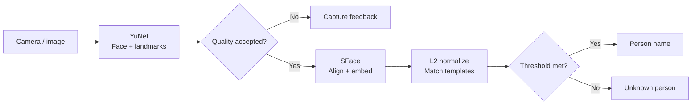

# FaceCompare

**A local desktop face recognition application powered by YuNet and SFace.** Capture camera frames, enroll people, recognize multiple faces, and reject unknown identities on a standard CPU. An image recognition CLI and experiment analysis tools are included.

[English](README.md) · [Chinese](README.zh-CN.md) · [User guide (Chinese)](docs/操作手册.md) · [Architecture](docs/ARCHITECTURE.md) · [Experiments (Chinese)](docs/EXPERIMENTS.md) · [Contributing](CONTRIBUTING.md)

[](https://github.com/DannyTheCreator/FaceCompare/actions/workflows/ci.yml)


*The actual application at startup with an empty gallery, without real faces or personal information. The desktop interface is in Chinese; control names below are translated for reference.*

## Features

- Card-based workspace with separate camera controls, recognition results, gallery statistics, and expandable run logs.
- Live camera preview, snapshot and continuous recognition, plus single-image recognition from the command line.
- Multi-face detection with per-face quality checks and matching; lightweight IoU tracking confirms names after consecutive matches.
- Top-K identity candidates and analysis snapshots with track IDs, displayed separately from the live view.
- Unknown-person rejection, with distinct feedback for no face, multiple faces, small faces, blur, and abnormal brightness.
- Enrollment, additional samples, preview, deletion, and SQLite persistence, with immediate template updates.
- Background recognition and enrollment to keep the interface responsive; expired results are cleared automatically.
- Fixed SHA-256 model verification, startup configuration validation, and support for image paths containing Chinese characters.
- Validation-set threshold calibration, image/video performance comparisons, raw CSV output, and JSON summaries.
- Score distributions, open-set operating-point curves, and per-scene metric reports generated from prediction CSV files.

## Quick start

Windows 10/11, Python 3.11 or 3.12, and a USB camera are recommended. No GPU is required.

```powershell
git clone https://github.com/DannyTheCreator/FaceCompare.git
cd FaceCompare
python -m venv .venv
.\.venv\Scripts\Activate.ps1
python -m pip install -r requirements.txt
python main.py --download-models
python main.py --check
python main.py
```

The first run requires an internet connection to download the YuNet/SFace models from OpenCV Zoo and verify their SHA-256 hashes. After downloading, enrollment and recognition run locally. The initial gallery is empty; enroll people before recognizing them.

On Linux, activate the environment with `source .venv/bin/activate`. Ubuntu also needs the Qt EGL runtime: `sudo apt-get install -y libegl1`. Automated checks cover Windows/Ubuntu and Python 3.11/3.12; camera compatibility needs verification on the target device.

## Launch and usage

```powershell
python main.py
```

1. Select the external camera from the device list, confirm it using the preview, and start it.
2. Use **Enroll / Add samples** to capture at least 5 clear images per person; 10–20 are recommended.
3. **Snapshot recognition** runs a single comparison. **Continuous recognition** processes frames at the configured interval, keeping only the latest pending frame.
4. A score below the threshold produces **Unknown person**. No-face, multiple-face, and quality failures have separate statuses.
5. **Gallery management** lets you preview and delete people or individual samples. Gallery changes take effect without restarting.

Switch between **Live view** and **Recognition analysis snapshot** on the left. The right sidebar shows recognition results, person/sample counts, and per-face candidates; it scrolls in smaller windows. Expand **Run log** at the bottom to view device connections and recognition events. Enrollment shows sample-count progress, and gallery management pairs a person list with sample previews.

The initial threshold `0.42` is an engineering starting point, not a final experimental finding. Calibrate it on an independent validation set, save the locked threshold in `config.json`, and then evaluate the test set.

```powershell
# Recognize an image without opening a window or camera
python main.py --image "D:\images\query.jpg" --json
python main.py --image "D:\images\group.jpg" --multi-face --json

# Use a separate configuration, for example for demo and experiment galleries
python main.py --config config.local.json
python main.py --version
```

`--image` uses the gallery from the selected configuration without writing a recognition log; it creates an empty gallery if none exists. Normal processing outcomes such as `unknown` and `no_face` return exit code `0`. Input, configuration, or environment errors return `1`.

## Algorithm and configuration



Identity templates are built by averaging normalized sample features and normalizing the mean again. An identity is accepted only when the highest score meets the threshold. Cosine similarity is not the probability that an identity is correct. Templates are separated by recognition model hash and preprocessing version.

All relative file paths are resolved against the configuration file's directory. Common settings are listed below:

| Setting | Purpose | Default |
| --- | --- | --- |
| `camera.default_index` | Preferred camera index | `0` |
| `camera.width` / `height` | Requested capture size; actual dimensions depend on the device | `640` / `480` |
| `camera.recognition_interval_ms` | Submission interval for continuous recognition | `600` |
| `camera.result_ttl_ms` | Result lifetime measured from frame capture | `2500` |
| `detection.detect_scale` | Detection scale; landmarks are mapped back to the original image | `0.5` |
| `quality` | Face size, sharpness, and brightness checks | See `config.json` |
| `matching.cosine_threshold` | Identity acceptance threshold | `0.42` |

The live view and analysis snapshot are displayed separately. Old results are cleared when a device is closed or switched, the gallery changes, or results expire. Changes affecting feature generation require a new preprocessing version and a rebuilt compatible gallery.

## Multi-face recognition and consecutive confirmation

Enable **Multi-face recognition / Tracking** and **Continuous recognition**. Each frame is detected once, then each face is checked and recognized independently. Up to 5 faces are processed by default, with an explicit report when the limit is exceeded. The analysis snapshot on the left shows track boxes; the per-face list on the right can expand Top-K candidates.

By default, a track must match the same identity 3 consecutive times before a name is displayed. Identity changes, unknown results, quality failures, missing detections, and device/gallery/mode changes interrupt or reset the evidence. Repeated snapshots of the same frame do not increase the confirmation count. Candidate similarity scores explain the match and do not imply identity acceptance.

Lightweight IoU tracking is intended for a small number of slowly moving faces. Fast motion or crossings may change track IDs, which are trajectory labels rather than real identities. Consecutive confirmation reduces display flicker; recognition performance still needs evaluation in the intended setting.

Single-face mode and enrollment still require exactly one face. Image queries with `--multi-face` return independent per-face results and do not perform confirmation across frames on a static image.

| Setting | Purpose | Default |
| --- | --- | --- |
| `matching.top_k` | Number of identity-level candidates | `3` |
| `tracking.max_faces` | Maximum faces processed per frame | `5` |
| `tracking.iou_threshold` | Minimum IoU for track association | `0.3` |
| `tracking.max_gap_ms` | Maximum gap before a track expires | `2000` |
| `tracking.confirmation_frames` | Consecutive matches required for confirmation | `3` |

## Data and scope

- Capture only people who have explicitly agreed to participate. Images remain in local `data/samples/` and must not be committed to a public repository.
- Separate enrollment, validation, and final test data by capture session. Adjacent frames from the same video must not be split across sets.
- Unknown people must be absent from the gallery. A person enrolled during a gallery-expansion demo can no longer count as an unknown identity in the final test.
- Database samples store both the model hash and preprocessing version. Incompatible features are excluded from the current template snapshot.

Dedicated liveness or photo-attack detection is not implemented, and performance across populations has not been validated. Face images, features, and databases remain local. See the [user guide (Chinese)](docs/操作手册.md) for backup and recovery procedures.

## Experiments and performance

Split data into enrollment, validation, and final test sets. Calibrate thresholds only on independent validation data. Final tests use a freeze record to verify the configuration, models, gallery, and inputs. The [experiment guide (Chinese)](docs/EXPERIMENTS.md) contains complete commands, manifest fields, and metric definitions. Use the [experiment record template (Chinese)](docs/实验记录模板.md) to document your results.

A separate [AT&T/ORL public-image benchmark](docs/PUBLIC_BENCHMARK.md) with a 20-person gallery produced the following results:

| Metric | Result |
| --- | --- |
| Correctly identified known queries | 60 / 60 |
| Correctly rejected unknown queries | 94 / 100 |
| Face detection failures | 6, all on unknown inputs |
| False accepts among valid unknown queries | 0 / 94 |
| B0 → B4 algorithm latency, p50 | 35.51 → 29.08 ms |

This experiment uses a separate low-resolution quality configuration and an image split without per-image capture-session metadata. These results do not establish default camera performance or cross-session generalization. The 6 detection failures are not counted as correct unknown rejections. See [performance analysis](docs/PERFORMANCE.md) for matching and queue measurements on synthetic inputs.

## Development and testing

```powershell
python -m pip install -r requirements-dev.txt
python tools/check_project.py
```

Tests use temporary databases and synthetic arrays. They cover configuration, template matching, model download failures, save rollback, experiment isolation, UI state, and source archive contents. After downloading the models, run `python tools/check_project.py --models` to verify them. Real-model integration tests use blank frames without accessing real faces or opening a camera. GitHub Actions runs regular checks on pushes and pull requests; test device behavior such as USB unplugging on the target computer using the user guide.

## Project structure

```text
app/                 Configuration, camera workers, detection, quality, features, matching, persistence, UI
experiments/         Threshold evaluation, fixed-image/video benchmarks, plotting
tests/               Unit tests independent of real face data
models/              ONNX models and model manifest generated on first download
data/                Runtime SQLite database and local face samples
docs/                Usage, architecture, and experiment documentation
tools/               Project checks, benchmark preparation, and maintenance tools
.github/             CI, issue templates, and pull request templates
```

The algorithm follows OpenCV's official `FaceDetectorYN` and `FaceRecognizerSF` APIs. Values in the interface are explicitly labeled as cosine similarity and are not interpreted as identity correctness probabilities.

## Sources and licenses

Application source code is released under the [MIT License](LICENSE). Models and dependencies retain their own licenses; see the [third-party notices](THIRD_PARTY_NOTICES.md).

Sources: [OpenCV official tutorial](https://docs.opencv.org/4.12.0/d0/dd4/tutorial_dnn_face.html), [YuNet](https://github.com/opencv/opencv_zoo/tree/main/models/face_detection_yunet), and [SFace](https://github.com/opencv/opencv_zoo/tree/main/models/face_recognition_sface).
