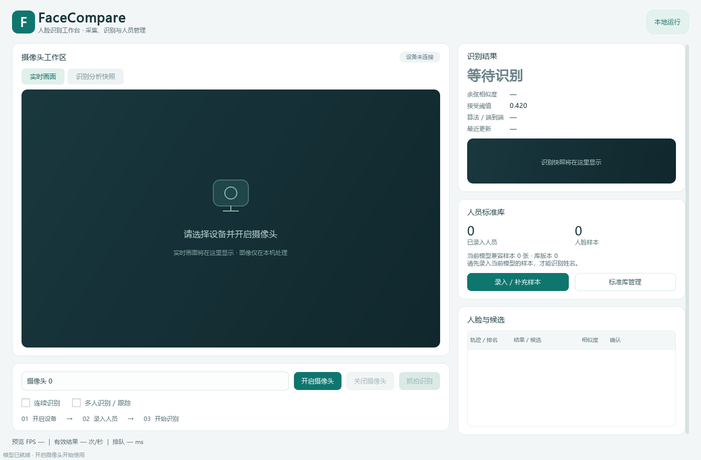
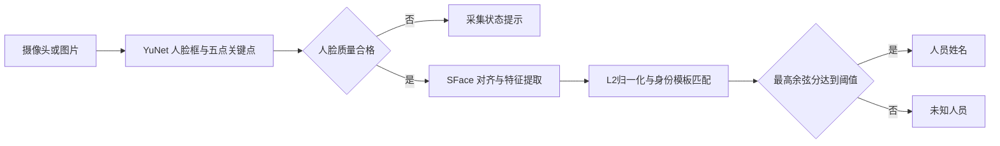

# FaceCompare

**基于 YuNet 与 SFace 的本地人脸识别桌面应用。** 使用普通 CPU 完成摄像头采集、人员录入、多人识别与未知人员拒识，并提供图片识别命令行和实验分析工具。

[English](README_EN.md) · [操作手册](docs/操作手册.md) · [架构说明](docs/ARCHITECTURE.md) · [实验复现](docs/EXPERIMENTS.md) · [贡献指南](CONTRIBUTING.md)

[](https://github.com/DannyTheCreator/FaceCompare/actions/workflows/ci.yml)




*实际应用的空库启动界面，不含真实人脸或个人信息。*

## 功能

- 摄像头实时预览、抓拍与连续识别，也可通过命令行识别单张图片。
- 多人模式一次检测、逐脸质量检查与匹配；轻量IoU轨迹关联，连续多次匹配后确认姓名。
- Top-K身份候选解释，带轨迹编号的分析快照与实时画面分开显示。
- 未知人员拒识；区分无脸、多脸、人脸过小、模糊和亮度异常。
- 人员录入、补充样本、预览、删除与SQLite持久化，模板即时更新。
- 后台处理识别与录入，避免界面阻塞；过期识别结果会自动清除。
- 固定模型SHA-256校验，启动配置验证，支持中文图片路径。
- 验证集阈值标定、图片/视频性能对照、原始CSV与汇总JSON。
- 预测CSV可生成分数分布、开放集工作点曲线和按场景的指标报告。

## 快速开始

建议使用 Windows 10/11、Python 3.11 或 3.12，以及 USB 摄像头。无需 GPU。

```powershell
git clone https://github.com/DannyTheCreator/FaceCompare.git
cd FaceCompare
python -m venv .venv
.\.venv\Scripts\Activate.ps1
python -m pip install -r requirements.txt
python main.py --download-models
python main.py --check
python main.py
```

首次运行需要联网下载 OpenCV Zoo 的 YuNet/SFace 模型，程序会校验 SHA-256。下载完成后，人员录入和识别均在本机运行。首次启动图库为空，需要自行录入人员。

Linux 使用 `source .venv/bin/activate` 激活环境；Ubuntu 还需要安装 Qt 的 EGL 运行库：`sudo apt-get install -y libegl1`。自动检查覆盖 Windows/Ubuntu 与 Python 3.11/3.12，摄像头兼容性需在实际设备上确认。

## 启动与使用

```powershell
python main.py
```

1. 在设备列表选择经预览确认的外置摄像头并开启。
2. 使用“人员录入 / 补充样本”，为需要识别的人员采集至少 5 张、建议 10–20 张清晰图像。
3. “抓拍识别”执行单次比对；“连续识别”按配置频率处理，待处理队列永远只保留最新帧。
4. 未达到阈值时界面显示“未知人员”，无脸、多脸和质量不足会显示各自状态。
5. “标准库管理”可预览并删除人员或样本；图库变化无需重启即可生效。

初始阈值 `0.42` 只是工程起点，不是最终实验结论。必须使用独立验证集标定，再将锁定后的阈值写回 `config.json`，然后评估测试集。

```powershell
# 不启动窗口或摄像头，识别一张图片
python main.py --image "D:\图片\查询.jpg" --json
python main.py --image "D:\图片\合照.jpg" --multi-face --json

# 使用独立配置，例如分开演示库和实验库
python main.py --config config.local.json
python main.py --version
```

`--image`使用所选配置的标准库，不写识别日志；库不存在时会创建空库。`unknown`、`no_face`等正常处理状态的退出码为0；输入、配置或环境错误返回1。

## 算法与配置



人员模板由归一化样本特征求均值后再次归一化生成。最高分达到阈值才接受身份，余弦相似度不代表身份正确概率。模板按识别模型哈希和预处理版本隔离。

所有相对文件路径都以配置文件所在目录为基准。常用配置如下：

| 配置 | 作用 | 默认值 |
| --- | --- | --- |
| `camera.default_index` | 首选摄像头编号 | `0` |
| `camera.width` / `height` | 请求采集尺寸，实际尺寸由设备决定 | `640` / `480` |
| `camera.recognition_interval_ms` | 连续识别提交间隔 | `600` |
| `camera.result_ttl_ms` | 从采集时刻计算的结果有效期 | `2500` |
| `detection.detect_scale` | 检测缩放，关键点映射回原图 | `0.5` |
| `quality` | 人脸尺寸、清晰度、亮度检查 | 见 `config.json` |
| `matching.cosine_threshold` | 身份接受阈值 | `0.42` |

主画面展示实时视频，右侧单独展示识别快照。关闭或切换设备、变更标准库、结果过期后清除旧结果。影响特征生成的修改需要更新预处理版本并重新建立兼容标准库。

## 多人识别与连续确认

勾选“多人识别 / 跟踪”和“连续识别”。每帧只检测一次，再逐脸检查质量和识别；默认最多处理5张，超过上限会明确记录。左侧“识别分析快照”展示轨迹框，右侧逐脸列表可展开Top-K候选。

默认同一轨迹连续3次匹配同一身份才显示姓名。身份变化、未知、质量失败、缺失、设备/库/模式切换会打断或重置证据；重复抓拍同一帧不会增加确认次数。候选相似度只用于解释，不代表接受身份。

轻量 IoU 跟踪适合少量人脸缓慢运动的场景。快速移动或交叉可能改变轨迹号；编号不代表真实身份。连续确认用于减少显示抖动，识别效果仍需在实际场景中评估。

单人模式和录入仍要求单脸。图片 `--multi-face` 返回独立逐脸结果，不对静态图片声称跨帧确认。

| 配置 | 作用 | 默认值 |
| --- | --- | --- |
| `matching.top_k` | 身份级候选数量 | `3` |
| `tracking.max_faces` | 单帧处理人数上限 | `5` |
| `tracking.iou_threshold` | 关联IoU下限 | `0.3` |
| `tracking.max_gap_ms` | 最大缺失时间 | `2000` |
| `tracking.confirmation_frames` | 连续确认次数 | `3` |

## 数据与适用范围

- 仅采集已明确同意参与实验的人员；图像保存在本机 `data/samples/`，不要提交到公开仓库。
- 注册、验证和最终测试按拍摄会话隔离。同一视频的相邻帧不能拆到不同集合。
- 未知人员不能出现在标准库。动态扩容演示中新录入的人，也不能继续计入最终未知测试。
- 数据库样本同时保存模型哈希和预处理版本；不兼容特征不会进入当前模板快照。

当前未实现专门的活体或照片攻击检测，也未验证跨人群识别性能。人脸图像、特征和数据库保存在本机，备份和恢复方法见操作手册。

## 实验与性能

按注册、验证和最终测试划分数据。阈值只在独立验证集上标定，最终测试使用冻结记录核验配置、模型、图库和输入。完整命令、清单字段和指标定义见 [实验复现](docs/EXPERIMENTS.md)，可用 [实验记录模板](docs/实验记录模板.md) 记录自己的结果。

在独立的 [AT&T/ORL 公开照片基准](docs/PUBLIC_BENCHMARK.md) 上，20 人标准库取得以下结果：

| 指标 | 结果 |
| --- | --- |
| 已知正确识别 | 60 / 60 |
| 未知正确拒识 | 94 / 100 |
| 未检出人脸 | 6 次，均为未知输入 |
| 有效未知查询误接受 | 0 / 94 |
| B0 → B4 算法时延 p50 | 35.51 → 29.08 ms |

该实验使用独立的低分辨率质量配置和图片划分，缺少逐张拍摄会话标签。结果不代表默认摄像头配置或跨会话泛化性能；6 次未检出未计作正确拒识。合成输入上的匹配与队列测量见 [性能分析](docs/PERFORMANCE.md)。

## 开发与测试

```powershell
python -m pip install -r requirements-dev.txt
python tools/check_project.py
```

测试使用临时数据库和合成数组，覆盖配置、模板匹配、模型下载失败、保存回滚、实验隔离、UI状态及源码包内容。已下载模型时可使用 `python tools/check_project.py --models` 验证模型。真实模型测试使用空画面，不读取真实人脸或启动摄像头。GitHub Actions在push和PR时运行常规检查；USB拔插等设备测试按操作手册在目标电脑执行。

## 工程结构

```text
app/                 配置、相机线程、检测、质量、特征、匹配、持久化、UI
experiments/         阈值评估、固定图像/视频性能对照、绘图
tests/               不依赖真实人脸数据的单元测试
models/              首次下载时生成的 ONNX 模型与模型清单
data/                运行时生成的 SQLite 数据库和本地人脸样本
docs/                使用、架构与实验文档
tools/               项目检查、基准准备和维护工具
.github/             CI、Issue模板和PR模板
```

算法路线依据 OpenCV 官方 `FaceDetectorYN` 与 `FaceRecognizerSF` 接口。界面中的数值明确标为余弦相似度，不将它解释为身份正确概率。

## 来源与许可证

应用源码采用 [MIT License](LICENSE)。模型与依赖遵循各自许可证，见 [第三方说明](THIRD_PARTY_NOTICES.md)。

来源：[OpenCV官方教程](https://docs.opencv.org/4.12.0/d0/dd4/tutorial_dnn_face.html)、[YuNet](https://github.com/opencv/opencv_zoo/tree/main/models/face_detection_yunet)、[SFace](https://github.com/opencv/opencv_zoo/tree/main/models/face_recognition_sface)。

