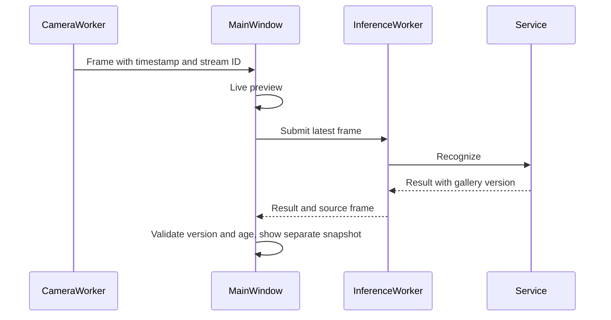

# FaceCompare architecture

| Module | Responsibility |
| --- | --- |
| `config.py` | Immutable config, path resolution and validation |
| `model_manager.py` | Official URLs, fixed hashes and atomic downloads |
| `detector.py` | Face boxes and landmarks mapped to source pixels |
| `quality.py` | Single-face, size, blur and brightness checks |
| `recognizer.py` | Alignment, embeddings and stable normalization |
| `matcher.py` | Identity means, read-only snapshots, matrix/loop matching |
| `repository.py` | SQLite records, images, versions and logs |
| `service.py` | Shared UI/experiment recognition and enrollment flows |
| `workers.py` | Camera lifetime, latest-frame queue and enrollment tasks |
| `ui/` | Controls, preview, snapshots and gallery management |

The service serializes inference and gallery updates with an `RLock`. Compatible embeddings are grouped by identity, averaged and normalized into read-only templates. Recognition results include the gallery version; camera packets/results include a stream ID. The UI rejects old versions, old devices and expired results.

Inference queue capacity is one; replacement affects pending work, not the active inference. Expired work is dropped before inference. Errors carry stream and mode-generation IDs too. Enrollment and gallery tasks use one-shot workers; closing is disabled while they run. Camera release is requested without blocking the UI; finished releases ownership. Window shutdown retains running workers and retries closing. A permanently blocked camera driver still needs target-device testing.

SQLite stores persons, samples, recognition logs and version metadata, with foreign keys and WAL. Sample files are prepared first; routine database failures roll back rows and remove prepared files. Deletion queues pending_file_deletions in the same transaction as deleting rows. File-access failures retain retryable cleanup records without blocking template refresh. Paths must resolve inside samples_dir. Integrity checks report missing/orphan images, unsafe paths, invalid features and incompatible versions. Unknown orphan files are never automatically deleted. Abrupt power loss can still require manual inspection.

Image paths are relative to the database directory. Model hash and preprocessing version prevent incompatible embeddings from entering templates. The public archive uses a file allowlist and contains no local gallery or weights.

Feature records and gallery version are loaded in one SQLite read transaction. Experiments use read-only database connections and do not initialize or migrate galleries. Validation may emit a content-based protocol freeze; final test checks it before and after evaluation. Settings, both models, logical gallery contents, images, source and environment are covered.

All application timestamps use time.perf_counter(), including externally supplied captured_monotonic values. Do not mix clock epochs with time.time() or time.monotonic() on Python versions where clocks differ. Algorithm, queue wait, service-lock wait and log writing are separate stages. Completion timestamps follow logging; log failures preserve recognition output with warnings. UI preview rate, accepted-result rate and benchmark inference throughput are distinct.

Scene inference detects once and evaluates faces independently through the shared recognition flow. The inference worker associates tracks and confirms identities. Enrollment and default evaluation remain single-face. Scene inference is bounded by `tracking.max_faces` and does not write the single-face recognition log.

`tracking.py` greedily associates boxes by IoU. Missing, unknown, quality-failed or changed identities reset evidence; device, gallery and mode changes reset tracks. IDs are trajectory labels. This original baseline lacks motion prediction and appearance-assisted association and is not ByteTrack.

Current scope: single- and multi-face processing, one centroid per identity, a configurable global threshold and no dedicated liveness/attack detection. CI verifies synthetic code behavior, not biometric accuracy or hardware reliability. Temporal performance needs separately annotated videos.
