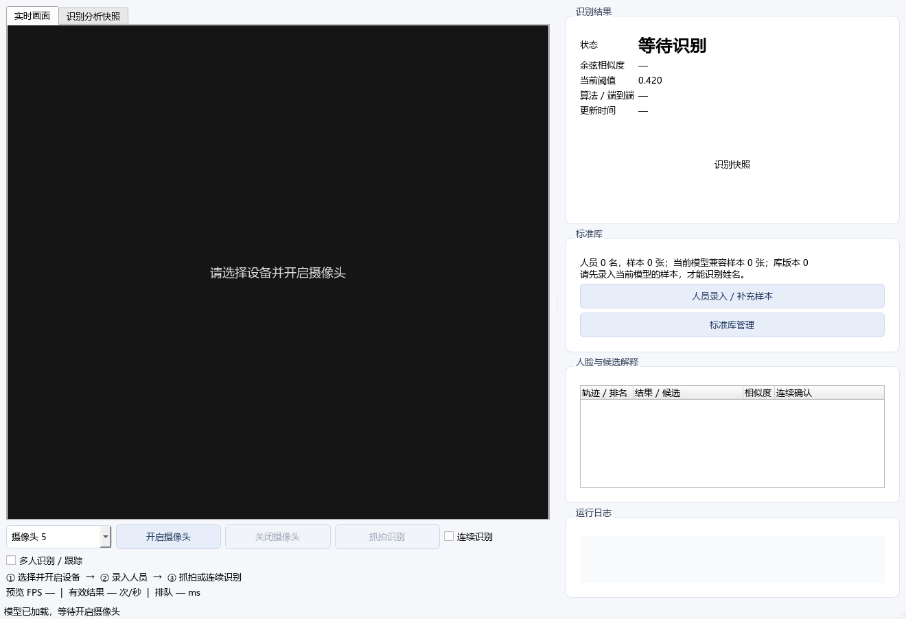
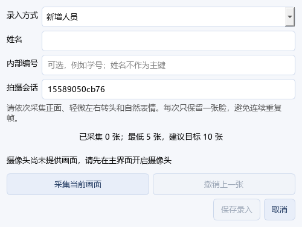
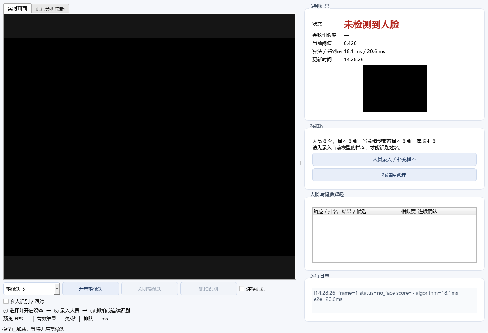
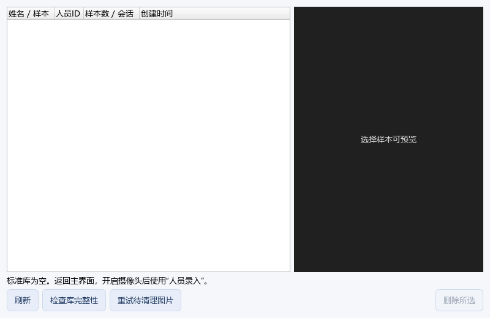

# Qt 桌面流程评审

日期：2026-10-13。使用 product-design:audit。工具为 PySide6 原生 QWidget.grab；实际应用服务和真实窗口，临时空图库，离屏渲染。未使用网页替代，也未连接真实摄像头。

本地原始截图：`profile_output/ui-before/` 与 `profile_output/ui-after/`。每组 01–05，逐张打开核验。最后一次渲染保存在`docs/assets/audit/`并随报告提供。空画面为真实 no_face 推理，非模拟成功身份；窗口标题栏和系统桌面不在 QWidget 截图内。所有截图可用 tools/render_audit.py 重建。

| 步骤 | 截图 | 发现与修改 | 验证范围 / 健康状态 |
| --- | --- | --- | --- |
| 1 启动 | 01-start.png | 空库只有计数，缺少后续动作；增加三步引导与兼容样本为空提示 | 真实空库截图通过 |
| 2 设备选择 | 02-device.png | 编号容易被理解为已发现设备；补充提示、可访问名称、异步释放状态 | 真实控件切换截图通过；USB 连接待实机 |
| 3 人员录入 | 03-enroll.png | 无法明确拍摄会话；增加可编辑会话字段与保存校验，保留缺画面原因提示 | 无摄像头按钮交互、保存状态与后台任务测试通过；真实人脸采样待验 |
| 4 识别 | 04-recognition.png | 时间戳粒度导致总时延可小于算法时延；统一高精度时钟，补充分开的预览/有效结果频率 | 空图真实模型结果和截图通过；真实身份与多人行为待验 |
| 5 标准库 | 05-gallery.png | 空库没有引导，删除按钮常亮，清空后预览可能残留；新增空态、选中控制、后台删除、完整性/待清理反馈 | Qt 按钮和临时库故障测试通过；真实大库/文件占用现场待验 |

截图可见的改善：文字清晰、操作提示在对应流程内、空态有下一步，错误不只靠颜色区分。已检查约 1320×900 主窗口、500px 录入对话框、800×520 管理窗口；不能据截图声称全尺寸布局或无障碍合规。高 DPI、读屏、完整 Tab 顺序和真实摄像头交互仍待目标电脑测试。

`python tools/render_audit.py --output profile_output/ui-check` 仅保存截图和执行明确的控件动作。pytest 的 Qt 交互测试另行证明旧模式错误过滤、保存按钮状态、后台保存/检查及非阻塞关闭请求；它们不能替代真实设备拔插测试。

## 本轮最终截图

1. 启动：空库引导。

2. 设备选择：编号控件，未连接设备。

3. 录入：会话输入和无画面提示。

4. 识别：空图真实模型返回no_face。

5. 管理：空库提示及禁用删除状态。

